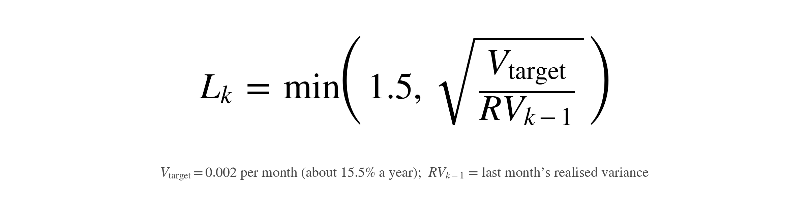

# Does monthly variance targeting beat just holding the index?

**Short answer: it beats the index at hitting a risk target, but most of that edge is one decade, and against a smarter benchmark it disappears in Japan.**

A rule that sets next month's leverage from last month's realised variance sounds like it must work. Markets are volatile, volatility clusters, so scale down when it's high and up when it's low. This repo tests that idea on 36 years of European and Japanese equity data, with the rule frozen before the test ran, and reports what happened, including the parts that don't flatter it.

[**Read the paper (4 pages, PDF)**](paper/volatility_targeting_paper.pdf)

---

## The rule

Each month, leverage is set from the previous month's realised variance:

<p align="center"></p>

**The one question, written down before any return was computed:** does this keep next month's realised variance closer to the target than simply holding the index?

## What happened

| | Europe | Japan |
|---|---|---|
| Average distance from target, **rule** | 0.652 | 0.737 |
| Average distance from target, **index** | 0.918 | 1.191 |
| Difference (Δ), 95% interval | **−0.266** [−0.517, −0.078] | **−0.454** [−0.710, −0.249] |
| Verdict on the prespecified test | pass | pass |
| Return (CAGR), rule vs index | 6.74% vs 7.50% | 1.78% vs 3.27% |

Negative Δ means the rule stayed closer to the target. It did, in both regions.

It also earned **less** than the index in every region tested, and it did not meet the stated drawdown limits (40% maximum drawdown, 36 months under water).

## The twist

The index is an easy opponent. The target sits below the index's usual variance (the index runs at 1.36 times the target in Europe and 1.97 times in Japan), so any rule that simply de-risks gets credit. So I added a harder opponent after seeing the results: exposure scaled by the average variance of **all earlier months**, which uses only information available at the time.

| Post hoc, no costs | Europe | Japan |
|---|---|---|
| Rule vs past-data benchmark | −0.183 [−0.388, −0.030] | **+0.115** [−0.002, +0.234] |
| Same, excluding 2000–09 | −0.046 [−0.159, +0.059] | **+0.151** [+0.029, +0.287] |

- In **Europe**, the rule beats the past-data benchmark only with the 2000–09 decade included. Without it, the difference is indistinguishable from zero.
- In **Japan**, the rule is *worse* than the past-data benchmark.

So "react to last month's variance" is not shown to add anything beyond "set exposure to the target on average". Those comparisons were run after the confirmatory result was seen, and the paper labels them post hoc.

## What this does not show

- That the rule raises returns. It lowered them.
- That it controls absolute losses. It did not meet the limits.
- That a real leveraged fund reproduces any of it. Measured fund costs (SSO and XS2D, 2× funds) came to about **1.6% a year beyond volatility drag**, per unit of the 2× fund.
- That Europe and Japan are two independent tests. Their monthly differences correlate about 0.63.

## A bonus: a machine-checked drag bound

Holding a leveraged position that resets daily costs "volatility drag". The paper includes a pathwise bound on that drag in terms of realised variance, with the finite-sum form **proved in Lean 4** (no `sorry`; only the standard axioms `propext`, `Classical.choice`, `Quot.sound`). The inequality is a corollary of Brown's results ([arXiv:2301.03186](https://arxiv.org/abs/2301.03186)). No novelty is claimed. Lean checks the deduction, not the data.

## Reproduce it

```bash
# 1. Get the Ken French daily regional files (see data/README.md for the exact hashes), then:
python code/practical_vt.py raw/data/french/regions/Europe_3_Factors_Daily.csv 20260902 Europe
python code/practical_vt.py raw/data/french/regions/Japan_3_Factors_Daily.csv  20260903 Japan

# 2. The post hoc comparisons (Table 4):
python code/posthoc_benchmarks_2026-11-23.py .

# 3. Rebuild the paper:
BODY=9.6 python paper/make_paper.py
```

Checked from a clean copy: the paper rebuilds, the post hoc results file reproduces byte for byte, and rerunning the frozen script on Japan gives the same primary statistic.

## What's in the repo

| Folder | Contents |
|---|---|
| `paper/` | The PDF, its source (`make_paper.py`) and figures. Table and abstract numbers are read from `results/`. |
| `code/` | `practical_vt.py` is the frozen test. The rest produce the post hoc, cost, fund and account results. |
| `results/` | Every result file cited in the paper, the freeze records and the Lean build logs. |
| `prereg/` | The prespecification text. |
| `lean/` | The proofs, with build instructions. |
| `data/` | Where to get the raw data, and the hashes of the files used. Raw data are not redistributed. |

## How much to trust the "prespecified" label

The test was frozen on 2026-11-22 at 16:22:24 UTC. The frozen script's SHA-256 is `dd67fd2e75c3914eb6682b7cf6cabc63e46346e25fabea5009f282aa5c5eeccd`, and it is byte-identical in this repo. Two honest caveats:

- The regional files were downloaded and integrity-checked about 33 minutes before the freeze. No return statistic had been computed on them.
- The freeze is documented by local file hashes and timestamps only. There was no external registration, so this is a prespecification record, not a registry entry.

## Known gaps

- The Lean project's Mathlib commit was not recorded; a rebuild is needed to pin it (see `lean/README.md`).
- The fund-shortfall and USD 100,000 account results use unofficial price series that can't be redistributed, so outsiders can inspect those results but not rerun them. The paper marks them as development evidence.
- Brown, Avellaneda–Zhang and Bongaerts et al. were read (preprint, working-paper and repository versions). Moreira–Muir, Harvey et al. and Cederburg et al. are cited from the reference list of Bongaerts et al. and bibliographic records, not read.

## About

Independent research by Mann Shah. The paper was written with substantial help from Claude (Anthropic) for the hypothesis design, code, Lean proofs, analysis and drafting, and the paper says so. Research, not investment advice.

## Licence and citation

- **Code and everything except the paper:** MIT, see [LICENSE](LICENSE).
- **The paper (PDF and figures):** CC BY 4.0, see [LICENSE-paper.md](LICENSE-paper.md).
- **Citing:** see [CITATION.cff](CITATION.cff). A DOI will be added after the Zenodo release.
